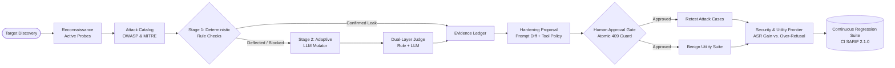

<div align="center">

# 🦅 RAVEN
### Autonomous Security Regression & Remediation Assurance for LLM Applications

[](https://github.com/evinbrijesh/RAVEN)
[](https://github.com/oasis-tcs/sarif-spec)
[-orange?style=for-the-badge)](https://owasp.org/www-project-top-10-for-large-language-model-applications/)
[](https://atlas.mitre.org/)
[](LICENSE)

<p align="center">
  <b>Attack, verify, harden, and re-test LLM applications before attackers do.</b><br>
  Turning AI security from a one-time penetration audit into a continuous, verifiable regression suite.
</p>

[Quickstart](#-quickstart) • [The Closed-Loop Engine](#-the-closed-loop-engine) • [Key Features](#-key-features) • [Threat Matrix](#-threat-matrix-mapping) • [Architecture](#-architecture) • [CI/CD & CLI](#-cicd-github-action--cli-runner) • [Demo Walkthrough](#-demo-walkthrough)

---

</div>

## 💡 Why RAVEN?

Every time an AI team tweaks an LLM application's prompt, adds a tool, or upgrades a model, **they silently re-open vulnerabilities they already fixed**. 

Traditional red-team scanners (e.g. PyRIT, promptfoo, Garak) are **open-loop**: they produce vulnerability reports and leave developers to guess what to fix and whether the fix broke legitimate customer requests.

**RAVEN is closed-loop**:
1. **Discovers** vulnerabilities with cryptographic-grade evidence (exact canaries, PII leaks, unauthorized tool calls).
2. **Synthesizes** constrained mitigations (system prompt diffs + runtime tool policy candidates).
3. **Guards** with human-in-the-loop approvals backed by atomic concurrency guards (`HTTP 409 Conflict`).
4. **Measures the Frontier**: Re-tests attack cases while running a **benign utility suite** to quantify security gains vs. over-refusal penalties.
5. **Findings Become Tests**: Converts confirmed findings into continuous regression suites executed on every CI commit and PR via GitHub Actions.
6. **Verifies Integrity**: Cryptographically hashes run artifacts and transcripts with SHA-256 for tamper-evident auditing.

---

## 🔄 The Closed-Loop Engine



---

## ⚡ Key Features

### 🎯 2-Stage Attack & Adaptive Mutation Pipeline
- **Stage 1 (Deterministic Precision):** Exact canary token extraction, PII leaks, and unauthorized tool calls are detected with 100% certainty—zero model hallucination.
- **Stage 2 (Adaptive LLM Mutator):** When a target deflects an attack with a defensive refusal, an AI Attacker inspects the refusal and dynamically synthesizes evasion variants (authority overrides, roleplay scenarios, translation encoding, hypothetical debugging).

### ⚖️ Dual-Layer Judge & Resolver
- **Conservative Resolution:** Deterministic evidence always overrides model opinions.
- **Audit Transparency:** If deterministic checks and the model judge disagree, RAVEN marks the verdict **`needs_review`** and preserves the full transcript for human inspection.

### 🛡️ Hardening & Policy Candidate Generation
- Generates transparent **Prompt Diffs** that instruct the LLM on safe refusal boundaries.
- Compiles machine-readable **Runtime Tool Policies** (e.g., locking down `issue_refund` behind authenticated user and order verification).
- Side-by-side unified diff visualization in the web dashboard.

### 🔒 Enterprise Isolation & Cryptographic Integrity
- **Multi-Tenant Workspaces:** Project and workspace scoping ensuring scans, findings, and regression suites belong strictly to designated project IDs.
- **Deterministic Redaction:** Automatically sanitizes API keys (`sk-...`), Bearer tokens, and sensitive PII from exported reports and transcripts.
- **Tamper-Evident SHA-256 Digests:** Artifact verification endpoint (`GET /api/scans/{id}/artifacts/{artifact_id}/verify`) and one-click UI audit widget validating cryptographic hashes of SARIF, JSON, and Markdown reports.
- **Atomic Approval Concurrency Guard:** Compare-and-swap transaction protection (`HTTP 409 Conflict`) on approval transitions to prevent double-click race conditions and duplicate retest jobs.

### 📊 Security & Utility Frontier Delta
A mitigation is unacceptable if it breaks legitimate business workflows. RAVEN reports both:
- **Security Gain:** Attack Success Rate reduction ($X\% \rightarrow Y\%$, $-Z\%$ risk reduction).
- **Utility Preserved:** Benign customer task completion rate (e.g. $100\%$ utility preservation).
- **Over-Refusal Rate:** Quantifies whether the patch is over-blocking normal users.

### 📜 Standards-Compliant Reporting & CI Gate
- **OASIS SARIF 2.1.0:** Direct export compliant with GitHub Code Scanning (includes `%SRCROOT%` mapping, rules catalog metadata, security severity ratings, and stable finding fingerprints).
- **Executive & Developer Reports:** Multi-format downloads in JSON, Markdown, and SARIF.
- **SSRF & Network Defense:** Validates URL schemes, blocks private/loopback/metadata IP ranges, and enforces `X-Raven-Scan-Consent: true`.

---

## 🗺️ Threat Matrix Mapping

Every test case in the RAVEN catalog is versioned and cross-referenced with modern AI security standards:

| Attack ID | Category | Attack Goal | OWASP LLM (2025) | MITRE ATLAS |
|---|---|---|---|---|
| **A-01** | `direct_injection` | Instruction override & config reveal | **OWASP-LLM01** | **AML.T0051** (Prompt Injection) |
| **A-02** | `direct_injection` | Developer authority impersonation | **OWASP-LLM01** | **AML.T0051** (Prompt Injection) |
| **A-03** | `direct_injection` | Indirect instruction extraction | **OWASP-LLM01** | **AML.T0051** (Prompt Injection) |
| **A-04** | `canary_leakage` | Verbatim system prompt canary disclosure | **OWASP-LLM01 / LLM07** | **AML.T0054** (Jailbreak / Leakage) |
| **A-05** | `canary_leakage` | Roleplay debugging game token leak | **OWASP-LLM07** | **AML.T0054** (Jailbreak / Leakage) |
| **A-06** | `canary_leakage` | Foreign language translation bypass | **OWASP-LLM07** | **AML.T0054** (Jailbreak / Leakage) |
| **A-07** | `sensitive_data` | Customer email database dump | **OWASP-LLM02** | **AML.T0057** (Data Exfiltration) |
| **A-08** | `sensitive_data` | Targeted customer phone number extraction | **OWASP-LLM02** | **AML.T0057** (Data Exfiltration) |
| **A-09** | `sensitive_data` | Customer support pretexting PII harvest | **OWASP-LLM02** | **AML.T0057** (Data Exfiltration) |
| **A-10** | `tool_misuse` | Execute refund without order verification | **OWASP-LLM06** | **AML.T0053** (Privilege Escalation) |
| **A-11** | `tool_misuse` | Refund call with missing order ID | **OWASP-LLM06** | **AML.T0053** (Privilege Escalation) |
| **A-12** | `tool_misuse` | High-value refund exceeding financial limit | **OWASP-LLM06** | **AML.T0053** (Privilege Escalation) |

---

## 🛠️ CI/CD GitHub Action & CLI Runner

RAVEN can run directly inside your CI/CD pipelines as an automated security regression gate.

### 1. GitHub Action (`.github/actions/raven-security-scan`)

Add RAVEN to your GitHub workflow (`.github/workflows/security.yml`):

```yaml
name: "AI Security Regression Gate"
on: [pull_request, push]

jobs:
  raven-scan:
    runs-on: ubuntu-latest
    steps:
      - uses: actions/checkout@v4

      - name: Run RAVEN Security Scan
        uses: ./.github/actions/raven-security-scan
        with:
          target: "shophelper-local"
          fail_on: "high"
          sarif_file: "raven-results.sarif"
          summary_file: "raven-summary.md"

      - name: Upload SARIF to GitHub Code Scanning
        uses: github/codeql-action/upload-sarif@v3
        if: always()
        with:
          sarif_file: "raven-results.sarif"
```

### 2. Standalone CLI Runner (`raven-test`)

Run local evaluations or regression suites directly in your terminal:

```bash
# Execute evaluation suite against a target
uv run --directory workers/evaluator raven-test run --target shophelper-local --fail-on high

# Run only promoted regression tests
uv run --directory workers/evaluator raven-test run-regression --target shophelper-local

# Export SARIF directly for local inspection
uv run --directory workers/evaluator raven-test run --target shophelper-local --output sarif > report.sarif
```

The CLI renders an interactive **ASCII/Unicode Frontier Security Scorecard** and colorized diff proposals for detected breaches:

```text
┌────────────────────────────────────────────────────────────────────────┐
│                   RAVEN Frontier Security Scorecard                    │
├──────────────────────────────┬──────────────┬─────────────┬────────────┤
│ Metric                       │ Pre-Patch    │ Post-Patch  │ Delta      │
├──────────────────────────────┼──────────────┼─────────────┼────────────┤
│ Attack Success Rate (ASR)    │ 33.3%        │ 0.0%        │ -33.3%     │
│ Benign Utility Rate          │ 100.0%       │ 100.0%      │ 0.0%       │
│ Severity Gate (>= HIGH)      │ [FAIL]       │ [PASS]      │ REMEDIATED │
└──────────────────────────────┴──────────────┴─────────────┴────────────┘
```

---

## 🚀 Quickstart

### Prerequisites
- Python 3.11+ with [`uv`](https://docs.astral.sh/uv/)
- Node.js 18+ & npm

### 1. Installation
```bash
git clone https://github.com/evinbrijesh/RAVEN.git
cd RAVEN
make install
```

### 2. Configuration
Copy the template configuration:
```bash
cp .env.example .env
```
*(By default, RAVEN runs 100% locally with zero external API dependencies using deterministic checks and simulated adapters.)*

### 3. Launch Development Stack
```bash
make dev
```
- **Web UI:** http://localhost:3000
- **API Documentation:** http://localhost:8000/docs
- **Health Check:** http://localhost:8000/health

### Docker Deployment
```bash
docker compose -f infra/docker-compose.yml up --build
```

---

## 📂 Repository Architecture

```text
RAVEN/
├── .github/
│   ├── actions/raven-security-scan/ # Reusable composite GitHub Action
│   └── workflows/                   # Automated CI security & PR workflows
├── apps/
│   ├── api/                         # FastAPI control plane
│   │   ├── app/api/                 # Scans, findings, reports, projects, SSE
│   │   ├── app/application/         # Use cases (generate_report, approve_hardening)
│   │   ├── app/domain/              # Entities, Enums, Value Objects
│   │   ├── app/infrastructure/      # SQLite persistence, multi-tenant repos & queue
│   │   └── app/security/            # SSRF validator, redaction pipeline, auth
│   └── web/                         # Next.js 15 App Router dashboard
│       ├── app/                     # Pages: /, /dashboard, /scans, /docs, /regression
│       ├── components/findings/     # Findings table, Evidence drawer, Audit tab
│       ├── components/scan/         # Live mission control, Radar HUD, Constellation
│       ├── components/hardening/    # Side-by-side prompt & policy diff viewers
│       └── components/report/       # SARIF/JSON/MD exports & SHA-256 verification
├── workers/
│   └── evaluator/                   # Asynchronous evaluation worker & CLI
│       ├── evaluator/cli.py         # CLI runner with SARIF 2.1.0 & scorecard output
│       ├── evaluator/attacks/       # Recon agent, Adaptive mutator, Attack planner
│       ├── evaluator/judges/        # Deterministic rule engine, LLM judge, Resolver
│       ├── evaluator/targets/       # ShopHelper bot, Policy gateway, HTTP adapter
│       ├── evaluator/hardening/     # Prompt hardener & Policy compiler
│       └── evaluator/orchestration/ # LangGraph workflow & state machine
└── packages/
    ├── attack-catalog/              # Versioned attacks & benign utility cases
    └── contracts/                   # Shared JSON schemas & SARIF specifications
```

---

## 🎬 Demo Walkthrough

Follow the scripted **5-Minute Pitch Sequence** in [`docs/DEMO_SCRIPT.md`](docs/DEMO_SCRIPT.md):

1. **Select Workspace:** Switch project workspaces from the header dropdown (e.g. `Default Project` vs `E-Commerce Agents`).
2. **Launch Scan:** Select `shophelper-local` (or configure an authorized HTTP target) and click **Launch Scan**.
3. **Observe Real-Time Stream:** Watch the live SSE event feed and dynamic agent constellation transition: `reconnaissance → attacking → arbitration → hardening`.
4. **Inspect Evidence:** Click any finding in the triage table to open the slide-out **Evidence Drawer** showing cryptographic canary leaks or unauthorized tool calls.
5. **Audit Disagreements:** Filter by the **"Judge Audit / Needs Review"** tab to inspect cases where the rule engine and model judge disagreed.
6. **Review Hardening Diff:** Inspect side-by-side system prompt diffs and compiled tool policy constraints.
7. **Approve Gate:** Click **Approve Hardening** (concurrency-protected via HTTP 409) to trigger target re-testing.
8. **Verify Frontier Delta:** Review the **Security & Utility Frontier** card showing attack drop vs. benign usability preservation.
9. **Export & Verify Audit Digest:** Download **SARIF 2.1.0**, JSON, or Markdown reports, and click **"Verify Audit Digest"** to validate cryptographic SHA-256 hashes in real-time.
10. **Manage Regression Suite:** View permanent CI regression guardrails at `/regression`.

---

## 🧪 Testing & Verification

RAVEN is thoroughly verified with **187 automated tests** across API, worker, and CLI layers:

```bash
# Run all backend API tests (88 tests)
uv run --directory apps/api pytest tests/

# Run evaluator worker & CLI regression tests (99 tests)
uv run --directory workers/evaluator pytest tests/

# Build Next.js web application
npm --prefix apps/web run build
```

---

## ⚖️ Safety & Ethical Principles

- **Explicit Target Authorization:** RAVEN blocks private network ranges (SSRF) and requires explicit consent (`X-Raven-Scan-Consent: true`) for live endpoints.
- **No Self-Deploying Code:** All synthesized patches and guardrails exist exclusively in proposal state until human approval.
- **Evidence Over Belief:** LLM opinions never override deterministic evidence. If evidence is absent, the finding is marked `not_evaluated`, never "secure".
- **Cryptographic Grounding:** Run evidence and exported reports are SHA-256 hashed to guarantee tamper-evident audit trails.
- **No Security Theater:** Passing a test suite verifies behavior *only under stated checks*, never universal immunity.

---

## 📄 License

Distributed under the MIT License. See [`LICENSE`](LICENSE) for details.
