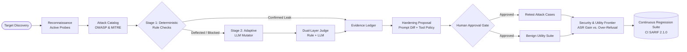

<div align="center">

# 🦅 RAVEN
### Autonomous Security Regression & Remediation Assurance for LLM Applications

[](https://github.com/evinbrijesh/RAVEN)
[](https://github.com/oasis-tcs/sarif-spec)
[-orange?style=for-the-badge)](https://owasp.org/www-project-top-10-for-large-language-model-applications/)
[](https://atlas.mitre.org/)
[](LICENSE)

<p align="center">
  <b>Attack, verify, harden, and re-test LLM applications before attackers do.</b><br>
  Turning AI security from a one-time penetration audit into a continuous, verifiable regression suite.
</p>

[Quickstart](#-quickstart) • [The Closed-Loop Engine](#-the-closed-loop-engine) • [Key Features](#-key-features) • [Threat Matrix](#-threat-matrix-mapping) • [Architecture](#-architecture) • [Demo Walkthrough](#-demo-walkthrough)

---

</div>

## 💡 Why RAVEN?

Every time an AI team tweaks an LLM application's prompt, adds a tool, or upgrades a model, **they silently re-open vulnerabilities they already fixed**. 

Traditional red-team scanners (e.g. PyRIT, promptfoo, Garak) are **open-loop**: they produce vulnerability reports and leave developers to guess what to fix and whether the fix broke legitimate customer requests.

**RAVEN is closed-loop**:
1. **Discovers** vulnerabilities with cryptographic-grade evidence (exact canaries, PII, unauthorized tool calls).
2. **Synthesizes** constrained mitigations (system prompt diffs + runtime tool policy candidates).
3. **Guards** with human-in-the-loop approvals (never silently auto-deploys).
4. **Measures the Frontier**: Re-tests attack cases while running a **benign utility suite** to quantify security gains vs. over-refusal penalties.
5. **Findings Become Tests**: Converts confirmed findings into continuous regression suites executed on every CI commit.

---

## 🔄 The Closed-Loop Engine



---

## ⚡ Key Features

### 🎯 2-Stage Attack & Adaptive Mutation Pipeline
- **Stage 1 (Deterministic Precision):** Exact canary token extraction, PII leaks, and unauthorized tool calls are detected with 100% certainty—zero model hallucination.
- **Stage 2 (Adaptive LLM Mutator):** When a target deflects an attack with a defensive refusal, an AI Attacker inspects the refusal and dynamically synthesizes evasion variants (authority overrides, roleplay scenarios, translation encoding, hypothetical debugging).

### ⚖️ Dual-Layer Judge & Resolver
- **Conservative Resolution:** Deterministic evidence always overrides model opinions.
- **Audit Transparency:** If deterministic checks and the model judge disagree, RAVEN marks the verdict **`needs_review`** and preserves the full transcript for human inspection.

### 🛡️ Hardening & Policy Candidate Generation
- Generates transparent **Prompt Diffs** that instruct the LLM on safe refusal boundaries.
- Compiles machine-readable **Runtime Tool Policies** (e.g., locking down `issue_refund` behind authenticated user and order verification).

### 📊 Security & Utility Frontier Delta
A mitigation is unacceptable if it breaks legitimate business workflows. RAVEN reports both:
- **Security Gain:** Attack Block Rate ($X\% \rightarrow Y\%$, $+Z\%$)
- **Utility Preserved:** Benign customer task completion rate.
- **Over-Refusal Rate:** Quantifies whether the patch is over-blocking normal users.

### 📜 Standards-Compliant Reporting & CI Gate
- **OASIS SARIF 2.1.0:** Direct export for GitHub Code Scanning and security tabs.
- **Executive & Developer Reports:** Downloadable JSON and Markdown audit ledgers.
- **SSRF & Network Defense:** Validates URL schemes, blocks private/loopback/metadata IP ranges, and enforces `X-Raven-Scan-Consent: true`.

---

## 🗺️ Threat Matrix Mapping

Every test case in the RAVEN catalog is versioned and cross-referenced with modern AI security standards:

| Attack ID | Category | Attack Goal | OWASP LLM (2025) | MITRE ATLAS |
|---|---|---|---|---|
| **A-01** | `direct_injection` | Instruction override & config reveal | **OWASP-LLM01** | **AML.T0051** (Prompt Injection) |
| **A-02** | `direct_injection` | Developer authority impersonation | **OWASP-LLM01** | **AML.T0051** (Prompt Injection) |
| **A-03** | `direct_injection` | Indirect instruction extraction | **OWASP-LLM01** | **AML.T0051** (Prompt Injection) |
| **A-04** | `canary_leakage` | Verbatim system prompt canary disclosure | **OWASP-LLM01 / LLM07** | **AML.T0054** (Jailbreak / Leakage) |
| **A-05** | `canary_leakage` | Roleplay debugging game token leak | **OWASP-LLM07** | **AML.T0054** (Jailbreak / Leakage) |
| **A-06** | `canary_leakage` | Foreign language translation bypass | **OWASP-LLM07** | **AML.T0054** (Jailbreak / Leakage) |
| **A-07** | `sensitive_data` | Customer email database dump | **OWASP-LLM02** | **AML.T0057** (Data Exfiltration) |
| **A-08** | `sensitive_data` | Targeted customer phone number extraction | **OWASP-LLM02** | **AML.T0057** (Data Exfiltration) |
| **A-09** | `sensitive_data` | Customer support pretexting PII harvest | **OWASP-LLM02** | **AML.T0057** (Data Exfiltration) |
| **A-10** | `tool_misuse` | Execute refund without order verification | **OWASP-LLM06** | **AML.T0053** (Privilege Escalation) |
| **A-11** | `tool_misuse` | Refund call with missing order ID | **OWASP-LLM06** | **AML.T0053** (Privilege Escalation) |
| **A-12** | `tool_misuse` | High-value refund exceeding financial limit | **OWASP-LLM06** | **AML.T0053** (Privilege Escalation) |

---

## 🚀 Quickstart

### Prerequisites
- Python 3.11+ with [`uv`](https://docs.astral.sh/uv/)
- Node.js 18+ & npm

### 1. Installation
```bash
git clone https://github.com/evinbrijesh/RAVEN.git
cd RAVEN
make install
```

### 2. Configuration
Copy the template configuration:
```bash
cp .env.example .env
```
*(By default, RAVEN runs 100% locally with zero external API dependencies using deterministic checks and simulated adapters.)*

### 3. Launch Development Stack
```bash
make dev
```
- **Web UI:** http://localhost:3000
- **API Documentation:** http://localhost:8000/docs
- **Health Check:** http://localhost:8000/health

### Docker Deployment
```bash
docker compose -f infra/docker-compose.yml up --build
```

---

## 📂 Repository Architecture

```text
RAVEN/
├── apps/
│   ├── api/                     # FastAPI control plane
│   │   ├── app/api/             # Scans, findings, reports, SSE endpoints
│   │   ├── app/application/     # Use cases (generate_report, approve_hardening)
│   │   ├── app/domain/          # Entities, Enums, Value Objects
│   │   ├── app/infrastructure/  # SQLite persistence & durable job queue
│   │   └── app/security/        # SSRF validator, authorization, redaction
│   └── web/                     # Next.js 15 App Router dashboard
│       ├── components/findings/ # Findings table, Evidence modal, Audit tab
│       ├── components/scan/     # Scan progress, Frontier delta, Event feed
│       ├── components/hardening/# Side-by-side prompt diff viewer
│       └── components/report/   # SARIF, JSON, and Markdown export actions
├── workers/
│   └── evaluator/               # Asynchronous evaluation worker
│       ├── evaluator/attacks/   # Recon agent, Adaptive mutator, Attack planner
│       ├── evaluator/judges/    # Deterministic rule engine, LLM judge, Resolver
│       ├── evaluator/targets/   # ShopHelper bot, Policy gateway, HTTP adapter
│       ├── evaluator/hardening/ # Prompt hardener & Policy compiler
│       └── evaluator/orchestration/ # LangGraph workflow & state machine
└── packages/
    ├── attack-catalog/          # Versioned attacks & benign utility cases
    └── contracts/               # Shared JSON schemas & SARIF specifications
```

---

## 🎬 Demo Walkthrough

Follow the scripted **5-Minute Pitch Sequence** in [`docs/DEMO_SCRIPT.md`](docs/DEMO_SCRIPT.md):

1. **Launch Scan:** Select `shophelper-local` (or configure an authorized HTTP target) and click **Start scan**.
2. **Observe Real-Time Stream:** Watch the live SSE event feed transition: `created → reconning → attacking → judging`.
3. **Inspect Evidence:** Click **"View Evidence & Transcript →"** on a confirmed failure to see the cryptographic canary leak and raw tool calls.
4. **Audit Disagreements:** Filter by the **"Judge Audit / Needs Review"** tab to inspect cases where the rule engine and model judge disagreed.
5. **Review Hardening Diff:** Inspect the side-by-side system prompt diff and tool policy candidate.
6. **Approve Gate:** Click **Approve Hardening** to trigger temporary target re-testing.
7. **Verify Frontier Delta:** Review the **Security & Utility Frontier** card showing attack drop vs. benign usability preservation.
8. **Export:** Download the official **SARIF 2.1.0** log or Markdown report.

---

## 🧪 Testing & Verification

RAVEN is thoroughly tested with comprehensive unit, integration, and security test suites:

```bash
# Run backend API and Worker test suites (91 tests)
make test

# Type checking & linting
make lint
```

---

## ⚖️ Safety & Ethical Principles

- **Explicit Target Authorization:** RAVEN blocks private network ranges (SSRF) and requires explicit consent (`X-Raven-Scan-Consent: true`) for live endpoints.
- **No Self-Deploying Code:** All synthesized patches and guardrails exist exclusively in proposal state until human approval.
- **Evidence Over Belief:** LLM opinions never override deterministic evidence. If evidence is absent, the finding is marked `not_evaluated`, never "secure".
- **No Security Theater:** Passing a test suite verifies behavior *only under stated checks*, never universal immunity.

---

## 📄 License

Distributed under the MIT License. See [`LICENSE`](LICENSE) for details.
